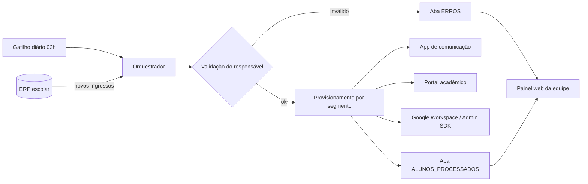

# Automação de Matrículas (versão demonstrativa)

Automação em Google Apps Script que busca os novos alunos no ERP escolar e provisiona automaticamente os acessos em cada plataforma (aplicativo de comunicação, portal acadêmico e Google Workspace), registrando sucessos e erros em uma planilha de controle com painel web para a equipe.

> Esta é uma versão demonstrativa, reescrita do zero, de um sistema que desenvolvi e uso em produção numa escola. Ela não contém código, dados, URLs ou credenciais da instituição. As integrações rodam com APIs simuladas e dados fictícios.

## Resultado no sistema real

- Cerca de 200 alunos novos por ano provisionados sem digitação manual
- Cerca de 25 minutos de trabalho manual eliminados por aluno
- Cerca de uma semana de trabalho da equipe economizada a cada período de matrículas
- Erros (e-mail ou telefone inválido, falha de API) centralizados num painel acompanhado mensalmente pela gestão

## Arquitetura



## Decisões técnicas

- **Fábrica de clientes** (`Clientes.gs`): o orquestrador não sabe se usa a API real ou a simulada; basta mudar `CONFIG.MODO_DEMO`.
- **Falha isolada por aluno**: um erro num cadastro é registrado e o lote continua.
- **Retentativa com backoff exponencial** para erros 5xx nas chamadas HTTP.
- **Credenciais fora do código**: tokens e URLs ficam em `PropertiesService`.
- **Login padronizado** `primeiro_nome.ultimo_nome`, sem acentos, com sufixo numérico em caso de duplicidade.
- **Funções puras testáveis** (`Utils.gs`) separadas do acesso a serviços do Google.

## Estrutura

```
src/
├── appsscript.json   # Manifesto (V8, fuso horário, web app)
├── Config.gs         # Configuração e leitura de segredos
├── Utils.gs          # Login, segmento e validações (funções puras)
├── MockApis.gs       # APIs simuladas com dados fictícios
├── Clientes.gs       # Fábrica de clientes HTTP e Admin SDK
├── Orquestrador.gs   # Fluxo principal e gatilho diário
├── Registro.gs       # Gravação na planilha de controle
├── Painel.gs         # Web app do painel
├── Painel.html       # Interface do painel
└── Testes.gs         # Testes das funções puras
```

## Como executar

1. Crie uma planilha no Google Sheets e abra **Extensões > Apps Script**.
2. Copie os arquivos da pasta `src/` para o projeto (ou use o [clasp](https://github.com/google/clasp) com `clasp push`).
3. Execute `testarTudo` para rodar os testes e `processarNovosIngressos` para processar os alunos fictícios.
4. Veja o resultado nas abas `ALUNOS_PROCESSADOS`, `ERROS` e `LOGS`.
5. Para o painel, publique em **Implantar > Nova implantação > App da Web**.

## Tecnologias

Google Apps Script (JavaScript V8) · Google Sheets · Admin SDK · APIs REST · HtmlService

## Autor

Guilherme Oliveira · [LinkedIn](https://www.linkedin.com/in/guilhermeoss)
